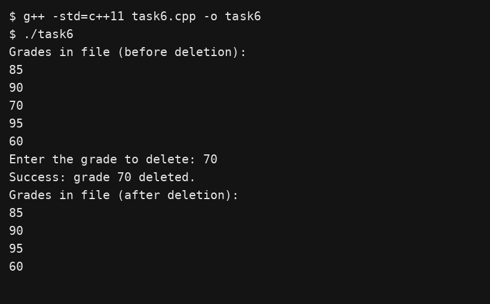

# File Organization Tasks

Seven separate C++ programs. Compile and run each program on its own.

```sh
g++ -std=c++11 task1.cpp -o task1
./task1
```

Replace `task1` with the task number. Files are read from and written to the program’s current working directory.

- `task1.cpp`: reads a student’s name, ID, and grade, then saves them in `Student.txt`.
- `task2.cpp`: reads `fruit.txt` and appends `Fresh Fruits`. Create the fruit list first, with one fruit per line.
- `task3.cpp`: creates `welcome.txt`, changes `body` to `one`, then saves `Hello Everyone`.
- `task4.cpp`: saves names and ages in `persons.txt`, then writes the youngest and oldest people to `results.txt`, including ties.
- `task5.cpp`: appends student records to `students.txt`, ending each record with `$`. Names can be up to 19 characters. Enter `y` to add another record or `n` to stop.
- `task6.cpp`: writes five grades to `grades.txt`, prints them, asks which grade to delete, and replaces the file with the remaining grades. `grades_before.txt` and `grades_after.txt` show the example before and after deleting 70.

### Task 6 output

The screenshot below shows a successful run that deletes grade 70.



- `task7.cpp`: stores four student names in a vector and prints them before and after sorting alphabetically with `sort()`.
